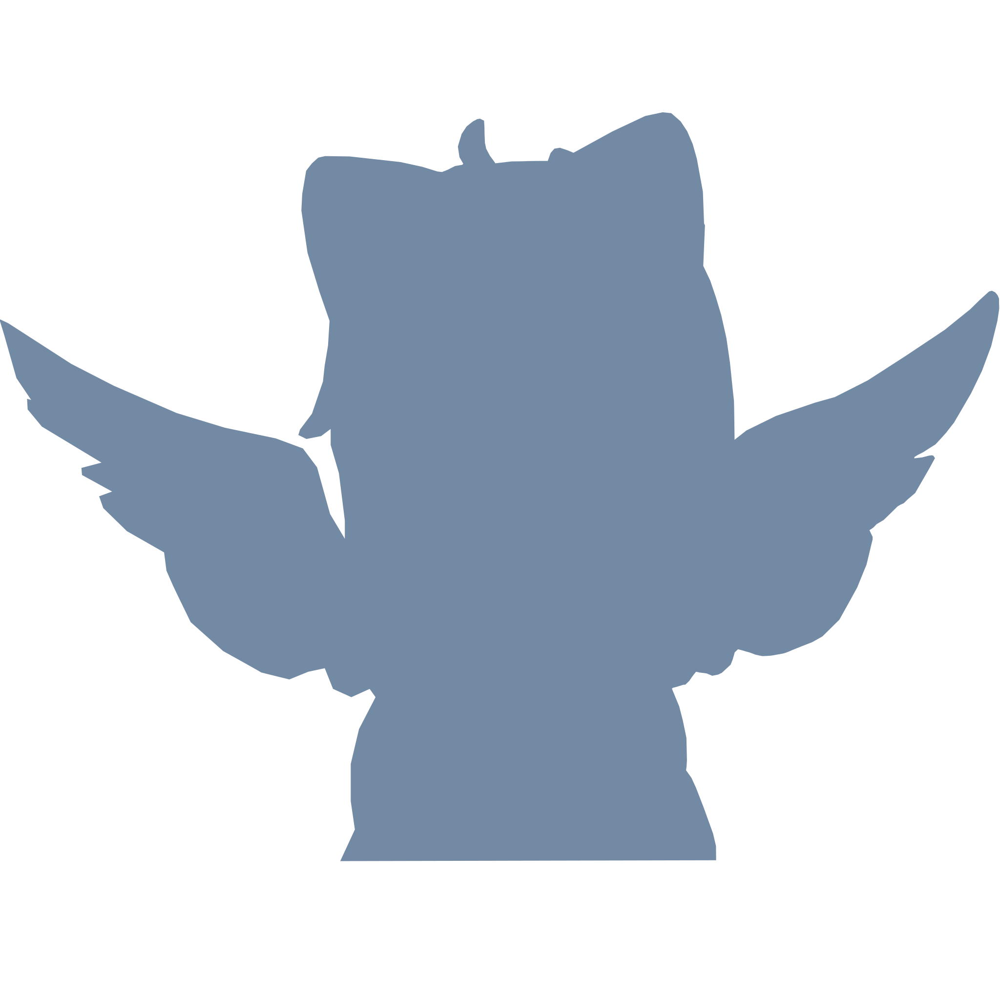

# The "End Point" of Kagi(Key) Liveries

Due to the derivative work limits（AI-genearted contents，EULA of official resources), and the pressure for graduate, the livery creation will be slowed down. What's more, the story of "anemoi"(a visual novel) make me disappointed, I think the creation of livery with Kagi(Key) theme should be paused at the Tsumugi Wenders livery(TSJ-VMUQ) and the Nishizono Mio livery(LB-822T).

From "Kanon" to "Summer Pockets", thank you, "Key" and Maeda Jun! I will go to the more free world and create more liveries.

Xe Project/FlyCat, October 8, 2026

